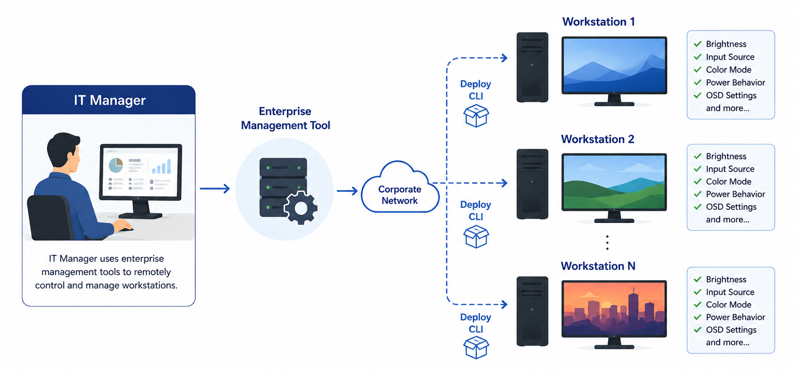
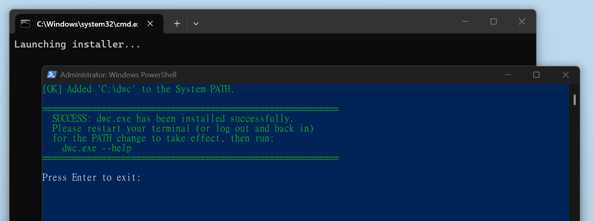
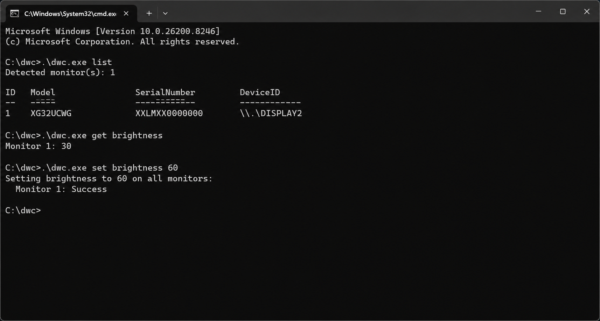

# 🖥️ ASUS Display Control

> 🌐 **言語**: [English](../README.md) · [繁體中文](./README.zh-TW.md) · [简体中文](./README.zh-CN.md) · **日本語** · [한국어](./README.ko.md) · [Español](./README.es.md)

ASUS Display Control は、ASUS モニターの設定を照会・変更するためのツールを提供します。
このリポジトリには、スクリプトや自動化のための [CLI](#-cli-クイックスタート) ツールと、自然言語によるモニター制御のための AI [Agent Skill](#-ai-agent-skill) が含まれています。

GUI（グラフィカルユーザーインターフェース）をご希望の方は、ASUS 公式サイトから [ASUS DisplayWidget Center](https://www.asus.com/content/monitor-software-osd-displaywidgetcenter/) をダウンロードできます。

## 📋 概要

| 対象ユーザー | ソリューション | できること |
| --- | --- | --- |
| 企業 IT 管理者 | [CLI](#-cli-クイックスタート) + IT ツール | 企業ワークステーション全体のリモートスクリプト、デプロイ、監査、および標準化されたモニター設定。 |
| 開発者 | [CLI](#-cli-クイックスタート) + スクリプト | コマンドプロンプト、PowerShell、またはスクリプトからのモニター制御の自動化。 |
| AI Agent ユーザー | [CLI](#-cli-クイックスタート) + [Agent Skill](#-ai-agent-skill) | AI アシスタントを通じた自然言語によるモニター制御。 |

## 🏢 企業 IT 管理

ASUS Display Control CLI を使用して、リモート IT 管理と企業ワークステーション全体の標準化されたモニター設定を実現します。

### 主なユースケース

- 輝度、カラープリセット、入力ソース、電源動作、または OSD 関連設定を構成する。
- スタートアップスクリプト、スケジュールタスク、または企業管理ワークフローを実行する。
- インベントリ管理、コンプライアンス確認、またはトラブルシューティングのためにモニター設定と機能を監査する。
- 新規デプロイ、交換デバイス、または部門全体のモニター設定を標準化する。

### 企業展開

- 大規模展開では、ASUS Display Control CLI を既存の企業エンドポイント管理インフラ（Microsoft Intune、Microsoft Configuration Manager（SCCM）、PowerShell Remoting、SSH など）を通じて配布・実行できます。
- ASUS Display Control CLI は、個々のワークステーション上のローカルモニター制御のみを提供することに注意してください。

## 🚀 CLI クイックスタート

### CLI ダウンロード

| プラットフォーム | ダウンロード | 実行ファイル |
| --- | --- | --- |
| Windows | [dwc_win.zip](https://github.com/ASUS-Display/asus-display-control/raw/main/cli/windows/dwc_win.zip) | `dwc.exe` |
| macOS | [dwc_mac.zip](https://github.com/ASUS-Display/asus-display-control/raw/main/cli/macOS/dwc_mac.zip) | `dwc` |

### CLI インストール

インストール後は、フルパスを指定せずに任意のディレクトリから CLI を実行できます。
インストールスクリプトは解凍したフォルダーに含まれています。

| プラットフォーム | スクリプト | 更新内容 |
| --- | --- | --- |
| Windows | `install.bat` | Windows 環境変数の `PATH` |
| macOS | `install.sh` | シェルプロファイルの `PATH` |

**注意**: インストール後はフォルダーを移動または削除しないでください — フォルダーが移動または削除されると CLI は動作しなくなります。

### CLI コマンド

**コマンドプロンプト**（Windows）または**ターミナル**（macOS）を開いて試してみてください：

| Windows | macOS | 説明 |
| --- | --- | --- |
| `dwc.exe help` | `dwc help` | 利用可能なコマンドと構文を表示 |
| `dwc.exe list` | `dwc list` | 接続中の ASUS モニターを一覧表示 |
| `dwc.exe info` | `dwc info` | 接続中のモニターの詳細情報を表示 |
| `dwc.exe get brightness` | `dwc get brightness` | 現在の輝度値を読み取る |
| `dwc.exe set brightness 60` | `dwc set brightness 60` | 輝度を 60 に設定する |

コマンド構文、サポートされているプロパティ、および使用例については、[CLI_REFERENCE.md](../cli/docs/CLI_REFERENCE.ja.md) を参照してください。

## 🤖 AI Agent Skill

コマンドを手動で入力する代わりに、AI アシスタントにモニターを制御させたい場合は Agent Skill を使用してください。

リクエスト例：

- 💬「モニター 2 の輝度を下げてください。」
- 💬「現在の入力ソースを表示してください。」
- 💬「すべてのモニターの輝度を 50 に設定してください。」
- 💬「このモニターがサポートしている設定を確認してください。」

Agent Skill は [skills/asus-display-control/SKILL.md](../skills/asus-display-control/SKILL.md) にあります。ローカルスキルファイルまたはカスタム Markdown 指示をサポートし、シェルコマンドを実行できる互換性のある Agent にコピーまたは参照してください。

### 互換性のある Agent

**ローカルマシン上で直接シェルコマンドを実行する** Agent であれば利用できます——これがモニターの DDC/CI ハードウェアに到達する条件です。隔離されたクラウドサンドボックスや仮想マシン内で実行される Agent は、シェルコマンドの実行に対応していてもモニターを制御できません。

**✅ 利用可能**（ローカルでシェル実行）：

- Cursor (Desktop App, Cursor CLI)
- Claude Code (Desktop App, Claude CLI, VS Code extension)
- GitHub Copilot (Desktop App, Copilot CLI, VS Code extension)
- Google Gemini CLI
- OpenAI Codex CLI
- OpenClaw
- Hermes Agent

**❌ 利用不可**（クラウド／サンドボックス実行）：

- Cursor Cloud Agent（クラウド）
- Claude Cowork（サンドボックス）
- GitHub Copilot Cloud Agents（クラウド）
- Google Jules（クラウド）
- Microsoft 365 Copilot（サンドボックス）
- OpenAI Codex Cloud（クラウド）

このリストは網羅的ではありません。特定の Agent が該当するか不明な場合は、シェルコマンドが自分のマシン上で実行されるか、リモート／クラウドサンドボックス内で実行されるかを確認してください。

## ⚙️ 必要環境

- Windows 10/11、または macOS 12 以降。
- DDC/CI をサポートする ASUS モニター。
- モニターの OSD メニューで DDC/CI が有効になっていること。
- DisplayPort または HDMI など、DDC/CI を通過するディスプレイ接続。

## 📚 ドキュメント

- [CLI リファレンス](../cli/docs/CLI_REFERENCE.ja.md)
- [AI Agent Skill](../skills/asus-display-control/SKILL.md)
- [ASUS DisplayWidget Center](https://www.asus.com/content/monitor-software-osd-displaywidgetcenter/)

## 📄 ライセンス

Apache License 2.0 の下でライセンスされています。詳細については [LICENSE](../LICENSE) を参照してください。
